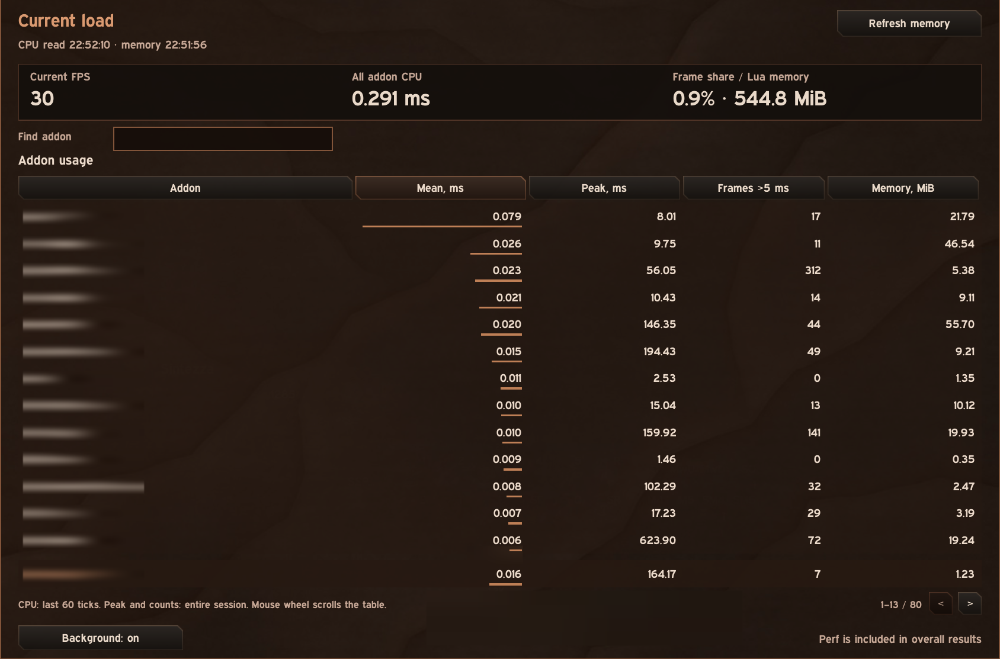
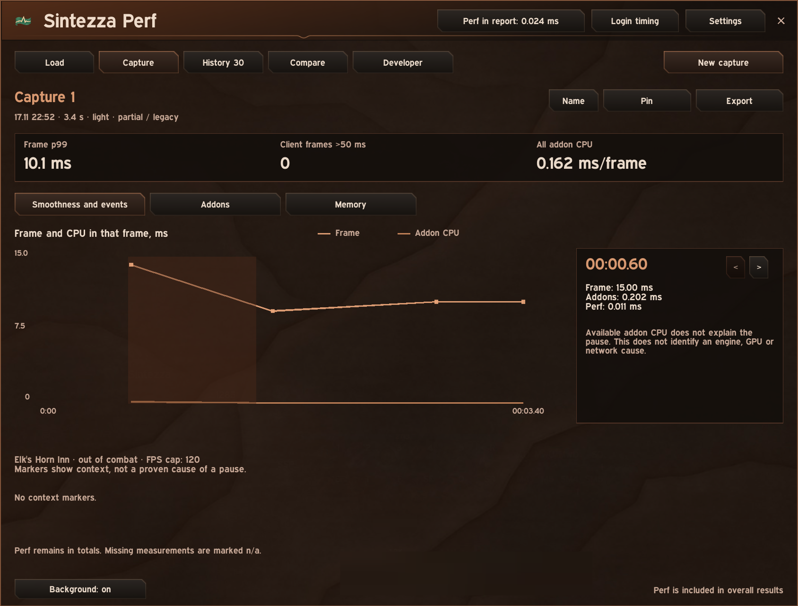
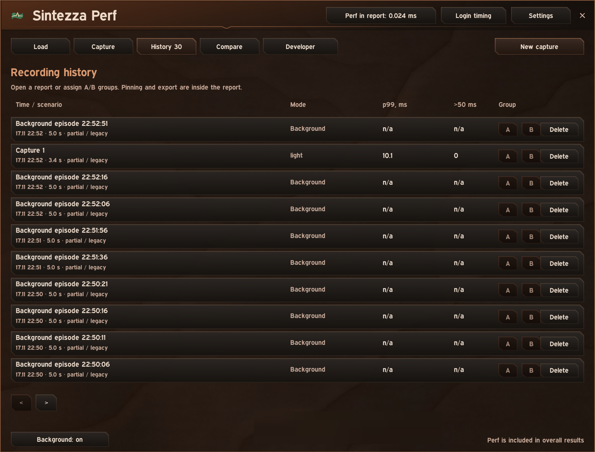
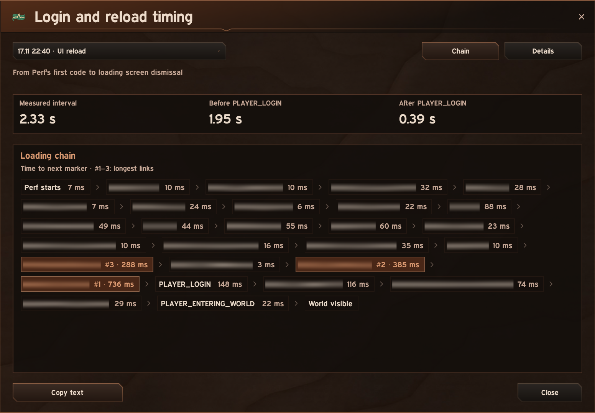

# Sintezza Perf

| CurseForge field | Value |
| --- | --- |
| Game | World of Warcraft |
| Class | Addons |
| Flavor and version | Forever 1.60.1 |
| Main category | Development Tools |
| Additional categories | Miscellaneous |
| CurseForge relations | Sintezza Theme (Optional Dependency) |
| Project license | MIT. See the repository for third-party notices. |

## Summary

Profile addon CPU and Lua memory, investigate frame-time spikes, and measure UI reloads in WoW Forever.

## Description

Open `/sperf` to see how much CPU time and Lua memory your addons use in WoW Forever. Record a slow moment to see how frame time and addon CPU changed together.

### Check addon CPU and memory

The Load table sorts addons by current CPU time, session peaks, slow-tick counts, or Lua memory.

Use **Load** for a live view. Memory has its own snapshot time, and CPU and peak columns cover different intervals.

### Record a slow moment

Select a point in the capture to compare the frame interval with addon CPU measured for that frame.

Start a light or detailed capture manually, at the next combat, or at the next boss encounter. Inspect long frames, p95/p99 frame intervals, and context markers. A detailed capture adds per-addon results. Background spike checks are optional and off by default.

### Reopen and compare captures

Reopen saved captures and background episodes in History. Assign compatible captures to A or B for comparison.

Pin or export a report from its detail view. Use **Compare** to see medians for completed A/B runs with compatible conditions.

### Review login and reload timing

The reload report shows the measured phases and highlights the three longest gaps between observed events.

Open **Login timing** or type `/sperf startup`. A link measures elapsed time to the next event, which can include work from the client and several addons.

### Add detailed profiling to your own addon

Any WoW Forever addon can opt in to `Sintezza_PerfAPI` v1. Register the modules, functions, and event counters you want to measure. Then open `/sperf dev` to record a module or a single point, inspect call counts and CPU timings, and compare repeated runs. You can also opt into Lua allocation measurements when the client provides them.

Add `Sintezza_Perf` to your addon's optional dependencies and use the adapter in the [developer API guide](https://github.com/ArtefactoO/Sintezza_Perf/blob/main/Docs/DeveloperAPI.md#english-integration-summary).

### Appearance

**[Sintezza Theme](https://github.com/ArtefactoO/Sintezza_Theme) is optional.** Perf works on its own. Install Theme and open `/stheme` to change the palette, fonts, and window appearance.

<!-- Changelog field -->

### Changelog

[View the release history on GitHub](https://github.com/ArtefactoO/Sintezza_Perf/blob/main/CHANGELOG.md).

Source, installation details, and credits are available on [GitHub](https://github.com/ArtefactoO/Sintezza_Perf).
