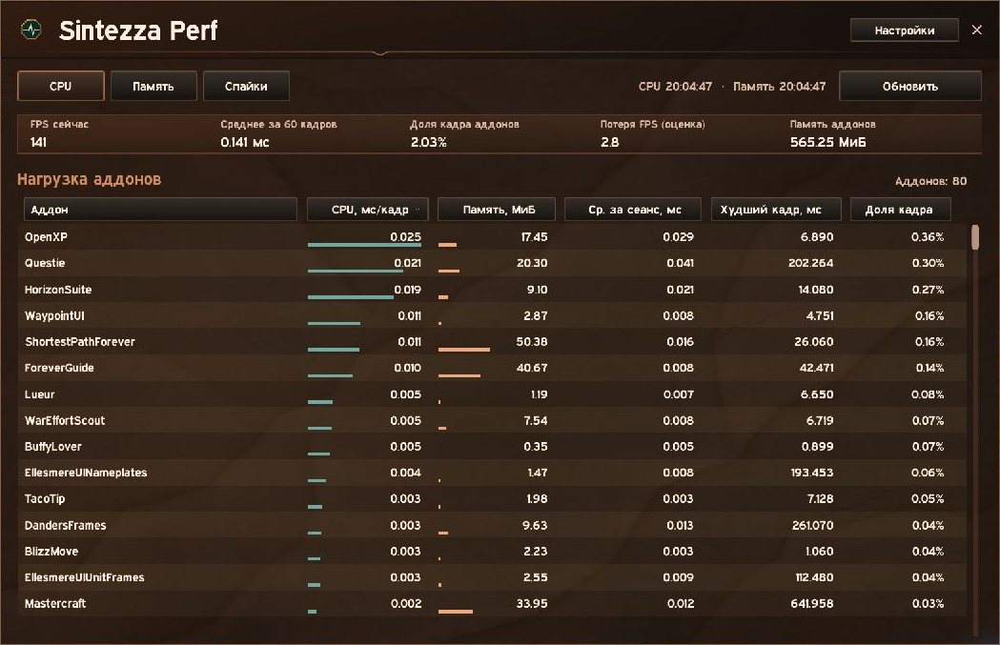
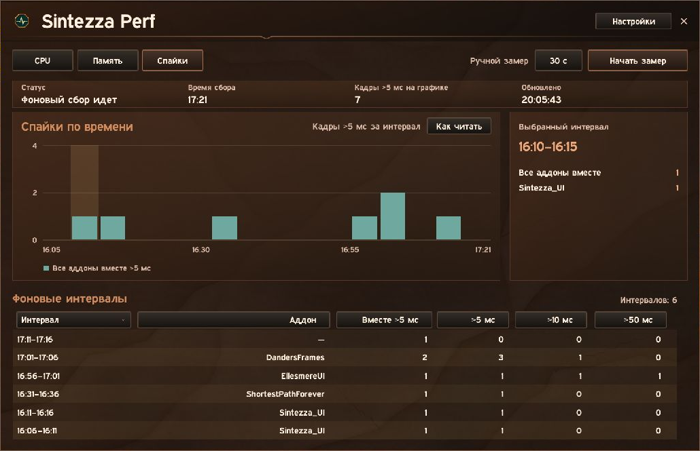

# Sintezza Perf

Inspect addon CPU time, memory, and spikes in WoW Forever with the game's built-in addon profiler. Each capture runs for a duration you choose and stops automatically. Sintezza Perf is a standalone addon.

## Installation

Put `Sintezza_Perf` in `Interface/AddOns` and enable it on the character selection screen. Open the window with the minimap button or `/sperf`. Use **Minimap icon** under **Settings → AddOns → Sintezza Perf** to show or hide the button. Right-click the button to hide it. [Sintezza Theme](https://github.com/ArtefactoO/Sintezza_Theme) is optional and supplies the shared palette, fonts, and movable minimap button.

## Using the window

- **CPU** and **Memory** show the same summary and table. The summary shows current FPS, average addon time, share of frame time, estimated FPS cost, and total Lua memory. The tabs open sorted by recent CPU time or Lua memory respectively. Click any heading to change the sort. Each bar scales to the highest value in its column. Frame share divides recent addon time by the client's recent average frame duration. The FPS estimate subtracts average addon time from the frame interval at the measured FPS.
- **Spikes** shows the timeline and interval table for background monitoring and timed captures. **How to read** explains the axes, marks, and colors. Click a bar to see which addons contributed.

While CPU or Memory is visible, Perf refreshes CPU and memory every minute. It reuses the native WoW memory snapshot if the client has refreshed it recently. **Refresh** reads CPU and takes a fresh memory snapshot immediately. Both timestamps appear beside the button.

The window keeps the latest capture after you close it. An active capture continues independently while the window is hidden. The progress indicator, chart bars, and memory bars animate when their values change. When Sintezza Theme is installed, its animation setting applies to this window.

| Command | Result |
| --- | --- |
| `/sperf` | Open or close the window |
| `/sperf minimap` | Show or hide the minimap button |
| `/sperf top` | Rank addons by recent average frame time |
| `/sperf top peak` | Rank addons by their peak during this session |
| `/sperf top spikes` | Rank addons by session frames over 5 ms |
| `/sperf top memory` | Take a Lua memory snapshot |
| `/sperf info AddonFolder` | Show one addon's averages, peak, and threshold counters |
| `/sperf watch 30` | Capture a 30-second interval. Supports 5–120 seconds |
| `/sperf stop` | Finish an active capture |
| `/sperf report` | Repeat the most recent capture report |
| `/sperf background on` | Enable background spike monitoring and remember the setting |
| `/sperf background` | Show the six most recent spike intervals, newest first |
| `/sperf background off` | Stop background monitoring and keep the report until reload |

Start a capture on the **Spikes** tab before reproducing a hitch. The report shows native counter deltas for addon frames over 5, 10, and 50 ms. The detailed list groups readings into roughly one-second intervals and names the addon with the most frames over 5 ms in each interval. The chart groups longer captures into slightly wider bins. Several addons can contribute in the same interval. A new peak appears when the addon exceeds its earlier session peak during the capture.

Click **Settings** in the Sintezza Perf window or open **Settings → AddOns → Sintezza Perf** to turn background monitoring on or off and view the six latest spike intervals. The open report updates every five seconds during monitoring. Click **Refresh** to update it immediately. The chat commands use the same setting and report.

With background monitoring enabled, Sintezza Perf reads the combined addon counter once every five seconds. If it increases, the addon reads individual counters and keeps the three leading contributors for that interval. A combined spike can occur when several addons together exceed 5 ms. The mode starts off by default, works with the window closed, and keeps its report in memory until a new monitoring run, logout, or reload.

Spikes charts the combined frames over 5 ms for the six retained background intervals. Click a bar to see the combined count and the leading contributors. The interval table lists the combined count alongside the per-addon counts over 5, 10, and 50 ms. When both reports exist, use **Background** and **Capture** to switch between them.

CPU also updates when either usage tab opens and about every two seconds on either usage tab during an active timed capture. The most recent timed capture stays in memory until logout or reload.

Each tab shows when its data was last read. Hover over summary metrics, table headings or values, and chart elements for explanations.

The native profiler API was checked against the [WoW Forever 1.60.1.70862 source snapshot](https://github.com/Gethe/wow-ui-source/blob/9dc84f0d3bbae1768ac3405b3716000bd93eda06/Interface/AddOns/Blizzard_APIDocumentationGenerated/AddOnProfilerDocumentation.lua).

## Gallery

## По-русски

Sintezza Perf показывает время работы аддонов, расход памяти и спайки в WoW Forever. Установи папку `Sintezza_Perf` в `Interface/AddOns`. Кнопка у миникарты и команда `/sperf` открывают окно. Видимость кнопки задает переключатель **«Значок у миникарты»** в настройках Perf. ПКМ скрывает кнопку. При установленной Sintezza Theme окно использует общую палитру, шрифты и перетаскиваемую кнопку у миникарты.

На вкладках **CPU** и **«Память»** одна сводка и таблица. В сводке видны текущий FPS, среднее время работы всех аддонов, их доля времени кадра, расчетная потеря FPS и общий объем памяти Lua. Вкладки открываются с сортировкой по CPU за последние кадры или по памяти соответственно. Нажми заголовок, чтобы отсортировать по другой колонке. Полная полоска соответствует максимальному значению в своей колонке.

На обеих вкладках CPU и память обновляются раз в минуту. Perf использует свежий снимок памяти из общего кеша WoW, если клиент уже его сделал. Кнопка **«Обновить»** сразу читает CPU и делает новый снимок памяти. Время обоих снимков видно рядом с кнопкой. CPU также обновляется при открытии каждой из этих вкладок и примерно раз в две секунды во время ручного замера.

Начни замер на вкладке **«Спайки»** перед сценарием, в котором игра подтормаживает. Подсказка **«Как читать»** объясняет оси, пороги и цвета. Нажми интервал на графике, чтобы посмотреть вклад аддонов. Строки отчета показывают кадры за порогами 5, 10 и 50 мс. Новый пик выводится, когда аддон превышает свой прежний максимум за сеанс.

Нажми **Настройки** в окне Sintezza Perf или открой **Настройки → Модификации → Sintezza Perf**, чтобы включить или выключить фоновый сбор и посмотреть последние шесть интервалов со спайками. Во время сбора открытый отчет обновляется раз в пять секунд. Кнопка **Обновить** показывает свежие данные сразу. Команды `/sperf background on`, `/sperf background off` и `/sperf background` работают с той же настройкой и отчетом.

Раз в пять секунд аддон читает общий счетчик кадров, в которых аддоны вместе превысили 5 мс. Когда счетчик растет, Sintezza Perf проверяет отдельные аддоны и запоминает до трех с наибольшим числом спайков за этот интервал. Отчет хранится в памяти до нового запуска сбора, выхода из игры или `/reload`.

График на вкладке «Спайки» показывает кадры, в которых суммарная работа аддонов превысила 5 мс, за шесть сохраненных фоновых интервалов. По нажатию на столбец видны общий счетчик и вклад отдельных аддонов. В таблице общий счетчик стоит рядом с количеством отметок по отдельным аддонам за порогами 5, 10 и 50 мс. Кнопки **«Фон»** и **«Замер»** появляются, когда доступны оба отчета.

`/sperf info Sintezza_Perf` показывает показатели самого профайлера. Скрытое окно перестает обновлять таблицы и график.

На каждой вкладке видно время последнего чтения данных. Наведи курсор на показатель, заголовок или значение в таблице либо элемент графика, чтобы увидеть пояснение.

## License

Sintezza Perf is distributed under the MIT License. [MIT License](LICENSE) · [Changelog](CHANGELOG.md)

[CurseForge listing fields](CURSEFORGE.md)
