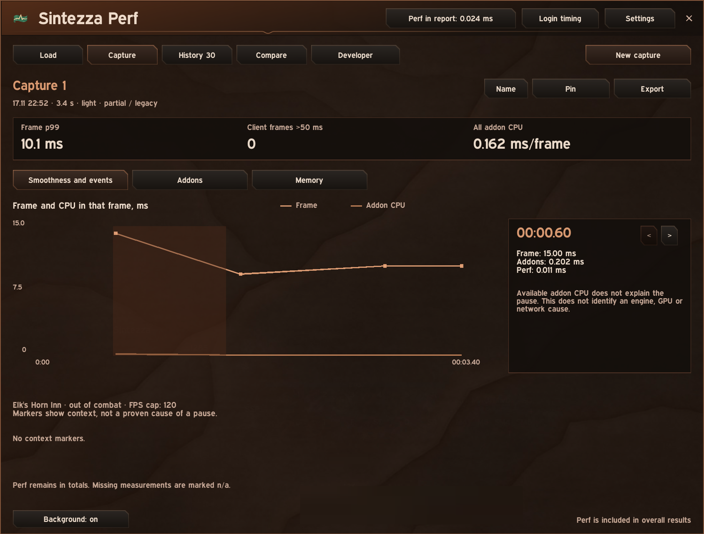

# Sintezza Perf

Inspect addon CPU time, Lua memory and spikes in WoW Forever. Open `/sperf` or left-click the minimap button. [Sintezza Theme](https://github.com/ArtefactoO/Sintezza_Theme) is optional; it supplies the shared palette, fonts, window appearance preferences and movable minimap button.

Developers can use `Sintezza_PerfAPI` v1 to profile specific functions, modules, and counters in any addon that opts in. See the [integration guide and Lua adapter](Docs/DeveloperAPI.md#english-integration-summary).

## Gallery

The Load table sorts addons by current CPU time, session peaks, slow-tick counts, or Lua memory.

Select a point in the capture to compare the frame interval with addon CPU measured for that frame.

Reopen saved captures and background episodes in History. Assign compatible captures to A or B for comparison.

The reload report shows the measured phases and highlights the three longest gaps between observed events.

## Views

- **Load** combines current CPU and Lua memory. Sort by a column, filter by addon folder name and refresh memory manually. CPU is the native mean over the last 60 ticks; the live peak and threshold counts cover the client session. Memory has its own snapshot time. These are addon Lua measurements, not total CPU/GPU utilization or the process's total RAM.
- **Capture** opens a setup window: scenario name, manual/next-combat/next-boss trigger, duration and light/detailed mode. Duration can be set from 5 to 120 seconds. Waiting is limited to five minutes and has no per-frame sampling. Recording is bounded to 120 seconds; an automatic capture also stops at combat/encounter end. A manual or safety stop is marked partial.
- **Smoothness and events** shows observed frame intervals, approximate p95/p99, client frames over 50 ms, and addon CPU paired with the selected worst frame. Context and manual markers do not establish causation. **Addons** shows per-addon data only for detailed captures. **Memory** shows up to 30 safe session snapshots available at completion, with their own time range and gaps.
- **History** keeps captures and background episodes across normal reloads and logouts. Rename, pin, delete with confirmation, export, or assign eligible records to A/B groups. Existing reports remain readable without invented frame-time data. SavedVariables are written by the client; crash recovery is not guaranteed.
- **Compare** shows group medians, run counts and observer cost. Recorded conditions are read-only. Profile, scenario/trigger, duration, client build, zone, group, combat state and FPS limit must be compatible before percentages appear. Unknown conditions, changed context, missing data, partial and legacy recordings are excluded. Fewer than three repeats is explicitly preliminary. Version numbers alone do not establish identical local code. A/B assignments follow the normal history limit. Pin reports you want to retain.

The chart retains combined spikes even when no individual addon exceeds 5 ms. Per-addon peaks and threshold counts cannot be summed.

Sintezza_Perf has its own table row and remains included in overall metrics. Hover controls, summary values, headings, rows and chart bars for the scope, units and limitations. Missing data is marked `n/a`; background reports do not invent averages, exact peaks or memory snapshots.

## Login and reload timing

Use **Login timing** in the header, `/sperf startup`, or right-click the minimap icon to open the login and reload timing window. Repeating the action closes it. The window offers saved login/reload selection, phase timings and the longest observed event gaps. Left-clicking the minimap icon opens or closes the main Perf window.

The compact selector chooses a saved report. **Copy text** is available whenever a report exists and opens its complete text already selected, with a visible Ctrl+C instruction. Press Ctrl+C there, then paste the report. The complete text includes the report name, time boundary, total duration and phases. Direct addon clipboard writes are restricted by the client.

New reports open on **Chain**, a chronological sequence of compact links sized to their content. Each link keeps its name, time and outgoing arrow together when wrapping to the next row. Names and times share a line; intervals below one second use milliseconds, and longer ones use seconds. The three longest positive intervals have highlighted surfaces and ranks #1–3 at their original chronological positions; equal durations retain observation order. Hover a link for its full name, next marker and timing scope. Exceptional long names wrap inside their link. **Details** keeps the explanation and plain-text chain. Switching tabs preserves the selected report and chain scroll position. Copy text includes every stored link and full name, using the existing seconds-based report format. Older reports retain their saved long intervals and explain that a new login or reload is needed for a chronological chain.

The startup observer stores at most 128 markers, including start and finish. Any omitted markers are counted, and the final aggregate interval is labeled. Link frames are created only when a report is opened and reused across reports, bounded at 129 units including an optional reload-command marker. Layout runs when a report opens or Theme appearance changes; scrolling does not run a Lua repaint callback. The report window is 920 × 640 before appearance scaling. No per-frame sampler is added. Short themed tooltips fit their content, with a bounded width.

Ordinary links use a subdued flat surface and faint border. Color emphasis is reserved for the three longest links. Centered muted chevrons connect the units: Theme supplies its shared glyph, and the standalone path draws a thin native chevron.

The latest ten unpinned loading reports are retained separately from performance captures and background episodes, which cannot evict them. Pinned records share the existing additional ten-record allowance. Older loading records already removed by the previous shared history limit cannot be restored.

Open **History** and select **Character login** or **UI reload**. Perf starts timing with its first Lua file. It normally ends when the loading screen closes. If only `PLAYER_ENTERING_WORLD` is seen, the report names that endpoint explicitly. The part of character login before Perf starts is outside the measurement. Ordinary `/reload` has the same starting boundary. `/sperf reload` records a timestamp before it requests the reload and includes that earlier interval when both clocks agree across the restart.

The report splits elapsed time at `PLAYER_LOGIN` and shows up to five long gaps between observed `ADDON_LOADED` events and startup boundaries. Folder names identify events at the ends of a gap. Its elapsed time can include multiple addons and client work. To investigate, repeat the same login or reload several times under the same conditions, change one addon or setting and compare the same measured interval. Loading reports can be pinned and exported. Collection uses startup events and a one-shot fallback, with no per-frame polling.

## Developer tools and optional API

Open **Developer** or `/sperf dev`. Modules, Functions, Updates and Regressions inspect explicitly registered sections. Initially this view is empty until an addon integrates with Perf; Sintezza_UI is not automatically instrumented.

Any WoW Forever addon can opt in to **`Sintezza_PerfAPI` v1** to measure its own synchronous Lua code. For example, time a nameplate refresh function, count repeated bag scan requests, or opt into allocation measurements for a function when the client supports them. Add `Sintezza_Perf` to the adopter's **OptionalDeps**, register stable modules/points once, then use `Call` for synchronous functions or `Count` for event counters. `SetVisible` and `MarkChanged` supply explicit state; `SetBuildLabel` distinguishes local code without changing the release version. Keep a direct path when Perf is absent. The [complete integration guide and copyable bridge](Docs/DeveloperAPI.md) documents every method, metadata field, failure mode, cost boundary and the Sintezza_UI handoff checklist.

Start with counters and 15 seconds. Captures are limited to 60 seconds, 128 selected points, 20,000 calls/signals and 32 nested calls. Choose a single row in Functions and use **Record this point** for narrower collection. CPU uses a Lua timing clock; allocation mode separately probes the native API and creates native result tables, so it costs more. No call arguments or return values are retained. Missing data stays unavailable. The original function is never retried after an error.

**Counters do not record milliseconds.** A report can contain thousands of calls and no timing. Use **Record CPU** on its module card to prepare a new CPU recording; press Start recording to begin. Existing reports are not converted. Counter-only points still have no timing in CPU mode. Visibility and code labels must be supplied separately by the integration.

With Sintezza_Theme present, Perf uses its window and panel surfaces, fonts, controls, input boxes, scrolling, tooltips, progress and data marks. Palette changes also reach chart colors; dialogs participate in shared window scale/opacity/layer preferences. Without Theme, Perf uses its standalone controls and appearance.

The last 20 developer reports persist separately in `Sintezza_PerfDB.developer`. Choose reports, assign A/B and compare a point across compatible complete repeats. Code labels and their source are required; manual labels are not verified hashes. Native Perf time and accounted service time overlap and must not be added or subtracted. Confirm improvements without active probes. See [phase-3 implementation and verification](Docs/Phase3.md).

## Collection cost and settings

Open **Settings** in the window or **Settings → AddOns → Sintezza Perf**.

Drag settings and report dialogs by the header outside combat. Their position is retained until reload. Settings show short explanations beside each control; hover for measurement and cost details.

| Setting | Behavior |
| --- | --- |
| Background collection | Off by default. Reads one combined counter every five seconds when unchanged. After a spike, reads per-addon counters and saves a light episode. No per-frame loop or memory walk. Skipped during a detailed capture. |
| Memory snapshots | Automatic: at most once per minute while Load is visible. Button only: use Refresh memory. Both modes defer scans during combat and captures. Other addons may refresh WoW's shared memory cache independently. |
| Reports to keep | Keep 20, 50 or 100 performance reports, separately the latest 10 unpinned loading reports, plus at most 10 pinned records across both groups. Old unpinned reports are pruned within their group. Each performance report is capped at 256 addon rows and 120 intervals; omitted addon counts are disclosed. |
| Minimap icon | Show/hide the window launcher. Left-click toggles the window. |

Light recording reads native combined `LastTime` and Perf's own value: two profiler reads per frame independent of the addon count. Detailed recording additionally samples tracked addons. Both modes use the elapsed interval supplied to the observer's frame callback; this is not a GPU presentation trace. The first callback is discarded because `LastTime` describes the previous tick. Native callback alignment still requires in-game verification. Unavailable or secret readings are counted rather than replaced with zero.

Frame distributions use 2,801 preallocated histogram buckets: 0.1 ms up to 100 ms, 1 ms up to one second, and 10 ms up to ten seconds, plus overflow. p95/p99 are bucket upper bounds, computed after recording, not sorted every frame. The maximum remains the observed value. Frame-interval percentiles and 1% low FPS are separate measures. Context is restricted to combat/encounter boundaries, zone/group changes and user markers; at most 80 markers are retained. No chat or player identities are collected automatically.

The collector stops early and saves a partial report if its measured cost exceeds **1 ms on average over 60 sampled frames**, or **20 ms in a single pass**. Its timing is included in the export and the profiler-row tooltip. This guard measures collection, not all window drawing or client activity, and does not guarantee a particular FPS. No forced garbage collection, `scriptProfile` changes or automatic disabling of other addons is performed.

With the window hidden, background disabled and no active capture, there is no redraw ticker, collector callback or memory scan. Visible CPU readings refresh every two seconds; an active capture view redraws at most once per second. Tables use reusable visible rows and dialogs are cached. A capture reuses an existing memory snapshot and records its original time/age; starting capture does not force a memory scan. A manual refresh requested during combat/capture is remembered and runs at the next safe read on the visible Load tab, without an extra timer.

## Commands

| Command | Result |
| --- | --- |
| `/sperf` | Open or close the window |
| `/sperf dev` | Open Developer tools and the optional integration API guide |
| `/sperf minimap` | Show or hide the minimap button |
| `/sperf watch 30` | Start a bounded detailed capture |
| `/sperf stop` | Stop and save the capture |
| `/sperf cancel` | Cancel waiting for an event |
| `/sperf mark [text]` | Add a bounded manual marker to the active recording |
| `/sperf report` | Print the latest capture |
| `/sperf startup` | Open or close the loading report window |
| `/sperf reload` | Record a start timestamp and reload the UI outside combat |
| `/sperf background on` / `off` | Change the background preference |
| `/sperf background` | Print the latest background episode |
| `/sperf top [recent\|peak\|spikes\|memory]` | Print the leading addons |
| `/sperf info AddonFolder` | Inspect a matching addon folder |

## Validation and API evidence

Native contracts were checked against [Forever 1.60.1.70938](https://github.com/Gethe/wow-ui-source/blob/bebcb6bf309cf41b41bd74f8ca651e6a105b2676/Interface/AddOns/Blizzard_APIDocumentationGenerated/AddOnProfilerDocumentation.lua) and its profiler metric enumeration. Source declarations do not establish native callback timing or actual performance on a player's machine.

See [phase-2 requirements and validation](Docs/Phase2.md), [remaining steps](Docs/Roadmap.md), the historical [phase-1 checkpoint](Docs/Phase1.md) and [autonomous test instructions](Tests/README.md). Tests are excluded from installation and release packages. No WoW client was launched for validation. Native controller directional navigation is not advertised; text boxes support Enter/Escape and existing cursor operation is preserved.

## License

[MIT License](LICENSE) · [Changelog](CHANGELOG.md) · [CurseForge listing fields](CURSEFORGE.md)
